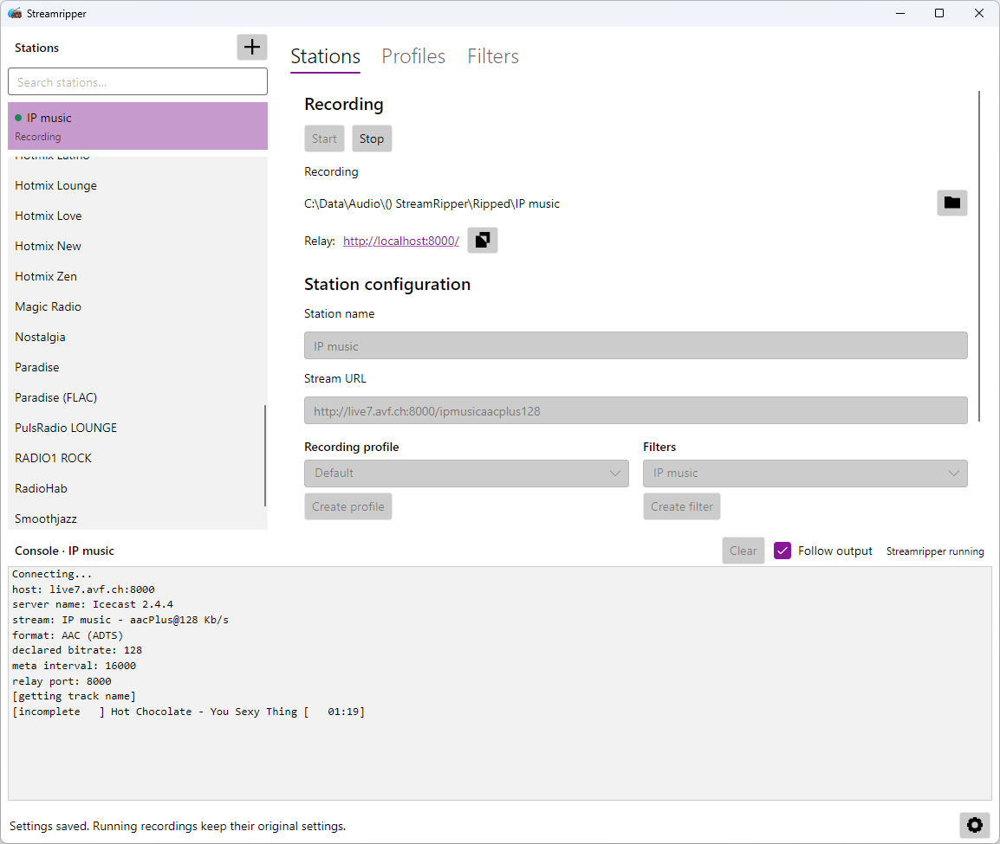
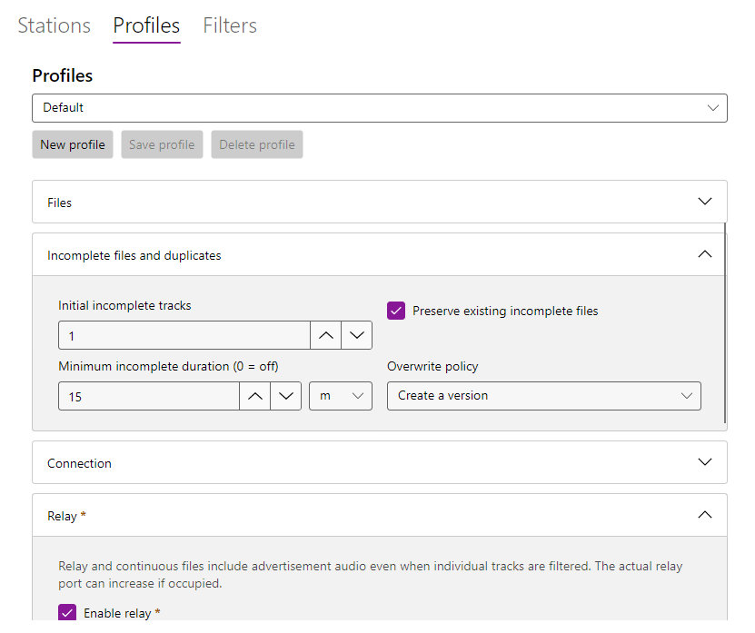
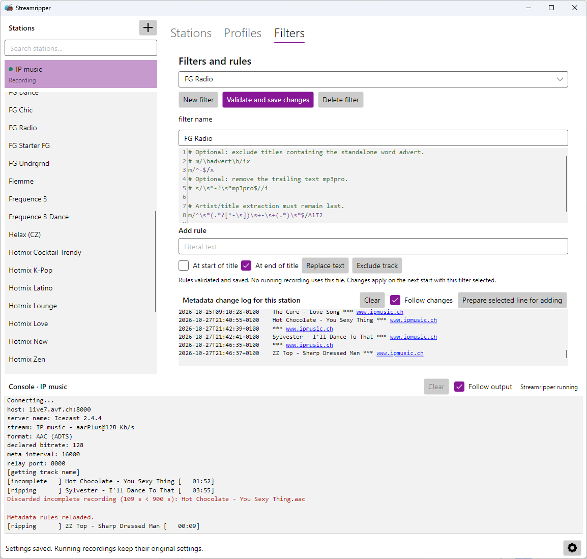

# Streamripper GUI

Record internet radio, keep your favorite stations together and save songs with
cleaner titles. Streamripper GUI gives the
[Streamripper recorder](https://github.com/Ashus/streamripper) a desktop interface
with recording profiles and filters you can reuse across stations.



- Record several stations at the same time.
- Add stations yourself or import an OPML station list, including MusicBee exports.
- Choose where recordings go and how files are named.
- Remove unwanted text from song titles or skip tracks that match your filters.
- Use English or Czech, with a light, dark or system appearance.

The application is under development. Windows x64 builds include a per-user
installer and a portable archive. DEB packages are available for Debian 13 amd64.

## Install and open

### Windows — installer

Run the `-win64-setup.exe` installer. It installs for your user in
`%LOCALAPPDATA%\Programs\Streamripper GUI` without administrator privileges and
adds a Start menu shortcut. Settings are stored separately in your user profile;
uninstalling leaves your settings and recordings intact.

The application requires **.NET Runtime 10 for Windows x64**, which is not bundled.
If it is missing, the installer offers an optional download and installation from
Microsoft. Installing the runtime can require administrator approval; you can
clear the preselected option and install it separately before opening the application.

### Windows — portable version

1. Install [.NET Runtime 10 for Windows x64](https://dotnet.microsoft.com/en-us/download/dotnet/10.0)
   if it is not already installed. Choose **.NET Runtime** under **Run apps**.
2. Extract the entire `.7z` archive into a folder where you can save files.
3. Open `StreamripperGui.exe` from that folder.

The archive includes the recorder and a `portable.flag` file. Your stations,
profiles and filters are saved in the `config/` folder beside the application.
This folder is created automatically on startup; old files beside the executable
are not imported. Keep the extracted
folder together when moving it or backing it up. Recordings are saved separately
in the folder you choose.

### Linux — Debian 13

Download both DEB packages: **streamripper-ng** (the recorder) and
**streamripper-gui** (the application).

Before the first installation, follow
[Microsoft's Debian 13 instructions](https://learn.microsoft.com/en-us/dotnet/core/install/linux-debian#debian-13)
to add its package repository and install **.NET Runtime 10**.

Open a terminal in the folder containing the two downloaded DEBs and run:

```sh
sudo apt install ./streamripper-ng_*.deb ./streamripper-gui_*.deb
```

APT installs both packages and any other required components. If an older
`streamripper` package is installed, it is replaced automatically.

If your desktop offers a graphical installer for `.deb` files, you can open the
packages there instead: install **streamripper-ng** first, then **streamripper-gui**.
The available graphical installer depends on your desktop; the terminal command
above works without one. See [Debian's package tools](https://wiki.debian.org/PackageManagementTools).

After installation, open **Streamripper GUI** from your application menu.
You can also start it by entering `streamripper-gui` in a terminal.

## Make your first recording

1. Open **Settings** with the gear button and choose a folder for your recordings.
2. Click **+** beside the station list and enter a station name and stream URL.
   Use the station's audio stream address rather than its website address.
   To bring in an existing station list, use **Import OPML** in Settings.
3. Select the station and click **Start**.
4. Click **Stop** when you are finished.

Recordings are organized into a separate subfolder for each station. Use the
folder button beside the recording path to open that station's recordings.

You can record more stations while another is running. Active stations stay at
the top of the list, and selecting a different station lets you view its progress
without stopping anything. Double-clicking a station also starts or stops it.

## Recording profiles

Use **Profiles** to choose filenames, how incomplete tracks and duplicates are
handled, connection settings and other recording options. Start with **Default**,
or create a profile and assign it to the stations that need different settings.

Click **Save profile** after editing. The new settings apply the next time you
start a recording.



## Cleaner titles with filters

Some stations add a website address, advertising text or other unwanted words to
song titles. In **Filters**, use **Replace text** to clean them up, or **Exclude
track** to skip matching tracks. Assign the filter to the stations that need it.

The **Metadata change log for this station** shows titles received from the
station. Select a line and use **Prepare selected line for adding** to turn it
into a starting point for a filter. You can also edit rules directly.

Click **Validate and save changes** when you are ready. A running recording that
uses the filter can pick up the changes; its console shows when they are applied.



## More information

For build instructions and technical documentation, see [the documentation index](https://github.com/Ashus/Streamripper-GUI/blob/master/docs/README.md).
